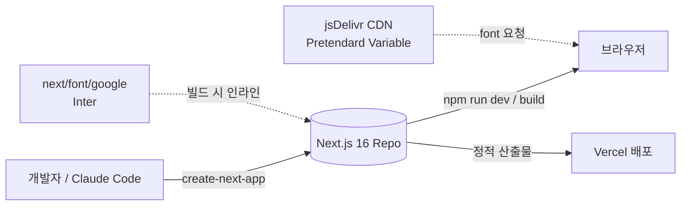
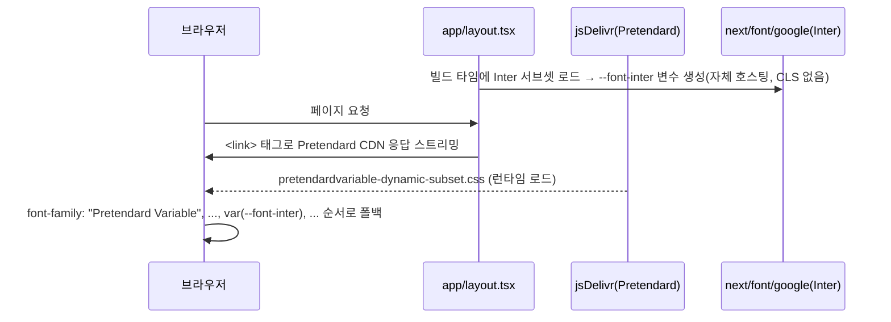

# Task 1 아키텍처 설계 — Next.js 프로젝트 초기화 & Tailwind CSS v4 구성

> `/sc:design` 산출물. 구현은 하지 않으며, `/sc:implement` 또는 `task-master set-status --id=1 --status=in-progress` 이후 진행.
> 대응 태스크: `.taskmaster/tasks/tasks.json` #1 (complexity 2, dependencies: none)

## 1. 목표 & 제약

| 항목 | 내용 |
|------|------|
| 목표 | Next.js 16 App Router + TypeScript + Tailwind CSS v4 스캐폴드를 구성하고, 이후 7개 태스크(Header/Footer, ImageSlider, 메인/문의/프로세스 페이지)가 그 위에 안전하게 쌓일 수 있는 기반을 만든다 |
| 범위 | 프로젝트 생성, 디자인 토큰(CSS 변수) 골격, 폰트 로딩 파이프라인, 설정 파일, `.gitignore`, `README.md` |
| 비범위 | 실제 페이지/컴포넌트 구현 (Task 2~8), 백엔드/폼 전송 (PRD상 명시적 제외) |
| 제약 | 완전 정적 사이트, 백엔드 없음, Windows(PowerShell) 환경, 저장소는 아직 git init 되지 않은 상태 |

## 2. 시스템 컨텍스트 (C4 Level 1)



이 태스크의 산출물은 위 그림에서 `Repo` 내부 구조와 `CDN`/`GoogleFonts` 연동 방식을 확정하는 것이다. 백엔드 노드는 존재하지 않는다(PRD 범위 제외).

## 3. 디렉터리 구조 (목표 상태)

```
landing_page_by_super_claude/
├── app/
│   ├── layout.tsx        # RootLayout: lang="ko", Pretendard <link>, Inter 변수 주입
│   ├── globals.css       # @import "tailwindcss"; + @theme inline 토큰
│   └── page.tsx          # (Task 4에서 실제 구현, 지금은 create-next-app 기본값)
├── public/
│   └── images/           # 슬라이드 placeholder 3장 (Task 3 선행 조건)
├── next.config.ts
├── postcss.config.mjs    # @tailwindcss/postcss
├── tsconfig.json
├── .eslintrc / eslint.config.mjs
├── .gitignore
├── README.md
├── package.json
├── PRD.md                 # 기존
├── CLAUDE.md               # 기존
└── .taskmaster/            # 기존
```

**설계 원칙**: `tailwind.config.js`는 만들지 않는다 — Tailwind v4는 CSS-first 구성이므로 토큰 SSOT는 `app/globals.css` 하나로 좁힌다. 이후 태스크(Header/Footer/ImageSlider/ContactForm)는 이 CSS 변수만 참조하고 별도 config를 추가하지 않는다.

## 4. 빌드·툴체인 아키텍처

```mermaid
flowchart TD
    TS[TypeScript] --> Next[Next.js 16 App Router]
    Next --> PostCSS[postcss.config.mjs]
    PostCSS --> TWPlugin["@tailwindcss/postcss"]
    TWPlugin --> Globals[app/globals.css\n@import tailwindcss]
    Globals --> Theme["@theme inline 블록\n(디자인 토큰)"]
    Next --> ESLint[ESLint]
    Next --> Vercel[Vercel 빌드/배포]
```

| 의존성 | 버전(고정) | 역할 |
|---|---|---|
| next | 16.3.6 | App Router, 빌드/배포 |
| react / react-dom | 19.2.8 | 렌더링 |
| tailwindcss | ^4 | 유틸리티 CSS (config-less) |
| @tailwindcss/postcss | ^4 | PostCSS 플러그인 |
| typescript | latest (create-next-app 기본) | 타입 안정성 |

버전은 `npx create-next-app@latest` 실행 시점의 최신값을 그대로 채택하고, 이 문서의 표는 하한선(minimum) 참고용으로만 사용한다.

## 5. 디자인 토큰 아키텍처 (SSOT: `app/globals.css`)

```css
@import "tailwindcss";

:root {
  --background: #ffffff;
  --foreground: #171717;
}

@theme inline {
  --color-background: var(--background);
  --color-foreground: var(--foreground);
  --color-brand: #3b82f6;                 /* PRD 4절: 포인트 컬러 1개 */
  --font-sans: "Pretendard Variable", Pretendard, var(--font-inter),
    -apple-system, BlinkMacSystemFont, "Malgun Gothic", sans-serif;
}

body {
  background: var(--color-background);
  color: var(--color-foreground);
  font-family: var(--font-sans);
}
```

- **계층**: `:root` 원시값 → `@theme inline` 시맨틱 토큰(Tailwind 유틸리티로 노출: `bg-brand`, `text-foreground`, `font-sans`) → 컴포넌트는 시맨틱 토큰만 사용.
- **확장 지점**: 이후 다크모드가 필요해지면(현재 PRD 범위엔 없음) `:root`에 미디어쿼리 오버라이드만 추가하면 되도록 원시값/시맨틱값을 분리해둔다.
- PRD 4절의 "무채색 + 포인트 컬러 1개" 제약을 `--color-brand` 단일 변수로 강제해, 다른 컴포넌트 태스크가 임의로 색을 늘리지 못하게 한다.

## 6. 폰트 로딩 아키텍처

두 개의 독립 경로를 두고 CSS 변수에서만 합류시킨다 (결합도를 낮추기 위함).



```tsx
// app/layout.tsx (설계 스펙 — 구현은 /sc:implement 단계)
import { Inter } from "next/font/google";

const inter = Inter({ variable: "--font-inter", subsets: ["latin"] });

export default function RootLayout({ children }: LayoutProps<"/">) {
  return (
    <html lang="ko" className={inter.variable}>
      <head>
        <link
          rel="stylesheet"
          href="https://cdn.jsdelivr.net/gh/orioncactus/pretendard@v1.3.9/dist/web/variable/pretendardvariable-dynamic-subset.css"
        />
      </head>
      <body>{children}</body>
    </html>
  );
}
```

## 7. 아키텍처 결정 기록 (ADR 요약)

### ADR-1: Tailwind v4 config-less(CSS-first) 방식 채택
- **결정**: `tailwind.config.js`를 만들지 않고 `@theme inline`으로 토큰을 정의한다.
- **이유**: v4 기본 워크플로우이며, 토큰 SSOT를 파일 1개(`globals.css`)로 좁혀 후속 컴포넌트 태스크의 설정 드리프트를 방지.
- **트레이드오프**: JS 기반 플러그인(예: 커스텀 `theme.extend` 함수)이 필요해지면 v3식 config로 되돌려야 함 — 현재 PRD 범위(정적 소개 페이지)에서는 발생 가능성 낮음.

### ADR-2: Pretendard는 CDN, Inter는 next/font/google
- **결정**: 한글 폰트는 jsDelivr CDN `<link>`, 영문 폰트는 `next/font`로 이원화.
- **이유**: Pretendard Variable 전체 서브셋을 `next/font/local`로 자체 호스팅하면 번들 크기가 커짐. Inter는 Google Fonts 공식 지원이라 `next/font/google`이 자체 호스팅+CLS 방지를 무료로 제공.
- **리스크**: CDN 장애 시 Pretendard 미로딩 → `font-sans` 폴백 체인(`var(--font-inter)`, 시스템 폰트)이 이를 흡수하도록 순서를 설계했음(6절).

### ADR-3: App Router + TypeScript (create-next-app 기본값 그대로)
- **결정**: 별도 커스터마이징 없이 `create-next-app@latest` 기본 옵션(App Router, TS, Tailwind v4, ESLint) 사용.
- **이유**: PRD 범위가 작고(정적 3페이지) 복잡한 라우팅/상태관리가 불필요 — 표준 스캐폴드로 유지보수 비용을 최소화.

## 8. 검증 매핑 (Test Strategy → 설계 요소)

| tasks.json Test Strategy | 이 설계에서 보장하는 지점 |
|---|---|
| `npm run dev` 정상 작동 | 3절 디렉터리 구조, 4절 툴체인 |
| Tailwind 클래스(`bg-brand`, `text-foreground`, `font-sans`) 적용 | 5절 토큰 계층 |
| Pretendard 폰트 로드 확인(Network 탭) | 6절 CDN 경로 |
| `npm run build` 성공 (필수) | 4절 의존성 버전 고정 |
| `npm run lint` 오류 없음 (필수) | 4절 ESLint 노드 |

## 9. 다음 단계

1. 이 설계 리뷰/승인 후 `task-master set-status --id=1 --status=in-progress`
2. `/sc:implement` 또는 직접 `npx create-next-app@latest .` 실행 → 본 문서 4~6절 스펙대로 `globals.css`/`layout.tsx` 조정
3. 완료 후 `npm run build && npm run lint` 통과 확인 → `task-master set-status --id=1 --status=done`
4. Task 2(Header/Footer 공통 레이아웃)는 본 문서의 5절 토큰을 그대로 상속해야 함
